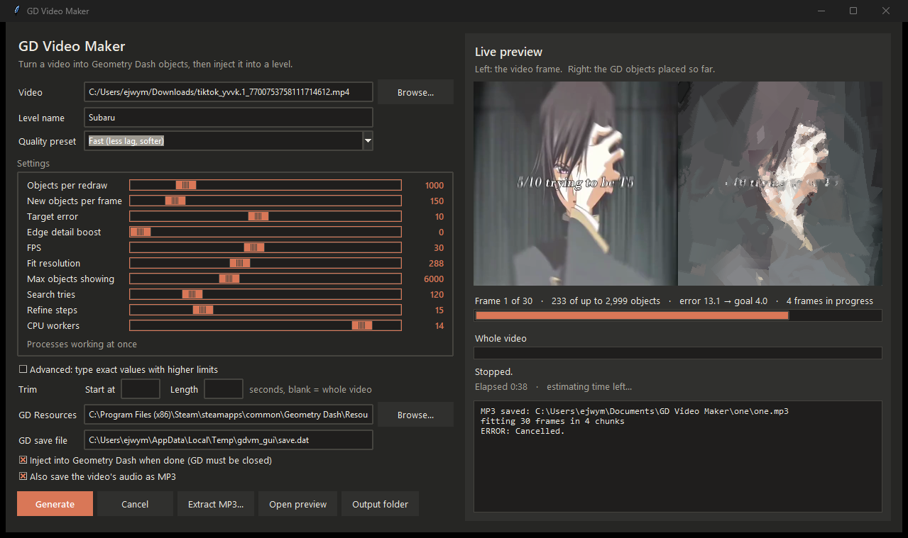
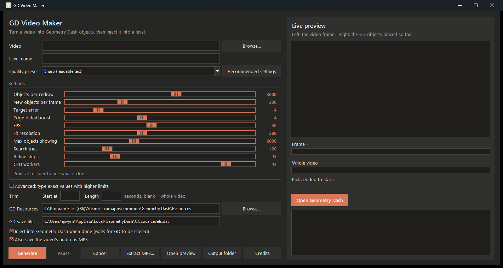
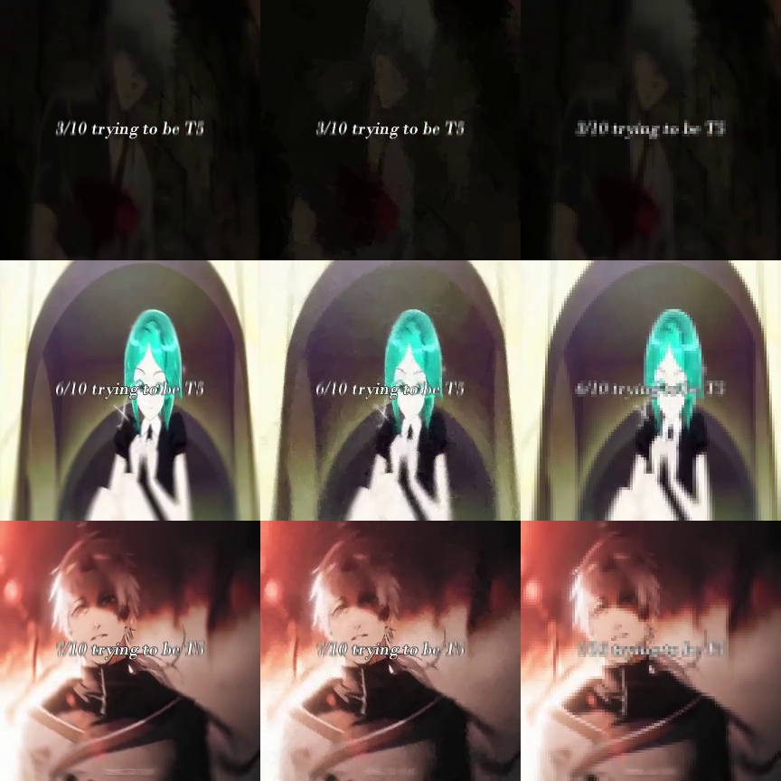
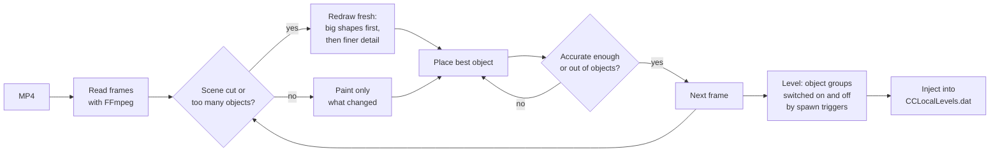
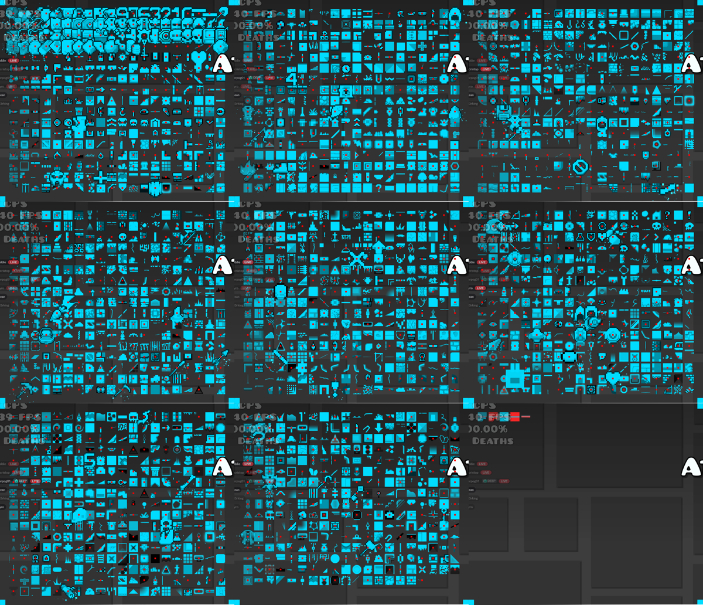

<div align="center">

# GD Video Maker

**Turn any MP4 into a Geometry Dash level, built from real editor objects.**

Pick a video, choose a quality, press Generate. It's fitted with hundreds of thousands of still GD objects and injected straight into your level. No AI, no mods, no pixel grid.


[Download](#download) · [How it works](#how-it-works) · [Settings](#settings) · [Build from source](#build-from-source) · [FAQ](#faq) · [Credits](#credits)



</div>

---

## Features

| Feature | Details |
|---|---|
| **Real GD objects, not pixels** | Each frame is built from 262 still editor objects (blocks, slopes, gradients, outlines and more), each placed, scaled, rotated and colored to match the video. |
| **Readable text and faces** | An edge-detail boost spends more objects on text, eyes and outlines than on flat background. |
| **Objects tested in the real game** | Every object was checked in GD for animation, pulsing, parts that won't take color, and layer order. Anything that failed is left out. |
| **Live preview** | Watch each frame being built object by object, beside the original. |
| ⏱**Progress and time left** | Frame and whole-video progress bars, the current frame number, its object count and error, plus elapsed time and an estimate of time left. |
| **Recommended settings** | Checks your CPU threads, free RAM and speed, then picks the sharpest quality that finishes in about an hour. |
| **Sliders for everything** | Ten settings as sliders, plus an **Advanced** mode to type values up to 10x higher. |
| **MP3 extraction** | Save the video's audio with one click, or automatically with every video. |
| **Trim** | Only fit part of a video with a start time and length. |
| **Save-safe injection** | Your save is backed up first, and the result is checked before anything is written. It refuses to run while GD is open, and won't overwrite levels it didn't make. |
| **Dark theme** | Because of course. |

<div align="center">

</div>

<a id="download"></a>

## Download

1. Download the latest **`GD-Video-Maker.zip`** from [Releases](../../releases).
2. Unzip it anywhere and open **`GD Video Maker.exe`**. Python, FFmpeg and everything else are included.
3. Close Geometry Dash, pick a video, name the level and press **Generate**.
4. Open the level in GD and press play.

> [!NOTE]
> Needs Windows 10/11 and the **Steam** version of Geometry Dash. If GD is installed somewhere else, point **GD Resources** at its `Resources` folder. Object art is read from your own install, so none ships with the app.

> [!TIP]
> On first run the app reads object art from GD, which takes a few seconds. After that it starts right away.

## Results

<div align="center">


*Left: the original video. Middle: GD Video Maker on Sharp. Right: a 95×95 pixel grid, for comparison.*
</div>

Measured on a 5-second clip (150 frames at 30 fps):

| | Error (lower is better) | Objects | Triggers |
|---|:---:|:---:|:---:|
| 31×31 pixel grid | 15.5 | 961 per frame | 40,574 |
| GD Video Maker, Fast | 9.4 | 19,064 total | 571 |
| GD Video Maker, Sharp | **5.6** | 82,154 total | 593 |

Objects stay on across frames, and only what changed gets new objects, so triggers stay very low. A 25-second full video on Sharp came to about 487,000 objects and 3,000 triggers, and was never more than about 6,300 objects on screen at once.

<a id="how-it-works"></a>

## How it works



**The object search.** For every placement it tries about 120 random objects of random types, sizes, angles and positions, aimed at where the picture is currently most wrong. It keeps the best three and nudges each one 15 times to improve it. The winner is painted, and the loop repeats until the frame reaches its target error or runs out of objects. It's the [Geometrize](https://www.geometrize.co.uk/) / [primitive](https://github.com/fogleman/primitive) method, using GD's own sprites as shapes.

**Coloring without color triggers.** Every object uses one base color channel plus its own HSV shift, so any color costs zero triggers.

**Timing.** Spawn-trigger chains switch each frame's group on and off, so playback doesn't depend on the player. The level runs in platformer mode with the player standing still.

**Persistent frames.** A redraw places a full picture. The frames after it only add objects on top for what changed, and old groups switch off at the next redraw. That keeps lag low and stops flicker.

## The object audit

Sprite names and art can't tell you whether an object animates, pulses with music or ignores color in-game. So every candidate was **measured inside Geometry Dash**:

1. `object_audit.py make` builds a level showing 2,697 candidates on 8 pages, each tinted cyan on grey.
2. The game is screen-recorded playing it.
3. `object_audit.py analyze` checks each object's cell in the recording.

| Check | What fails |
|---|---|
| **Still** | Anything that moves, spins or pulses during its 3 seconds |
| **Takes color** | Black or untinted parts; more than 10% of the object staying grey or black fails |
| **Looks right** | Hidden extra parts, wrong shapes, nothing drawn |
| **Layer order** | Whether objects from different sprite sheets stack in the order they're given |

<div align="center">


*Part of the audit report. Red dots mark objects that failed.*
</div>

**What it found:**
- Hundreds of decorations pulse or spin even with no song playing.
- Many objects only color a thin rim and stay black inside. Those were the cause of black panels in early versions.
- **Layer order breaks between sprite sheets:** GD draws `GJ_GameSheet` objects above `PixelSheet_01` and `GJ_GameSheet02` objects whatever order you give them. So the library only uses one sheet.

262 objects passed everything. They're listed in [`verified_objects.json`](verified_objects.json).

<a id="settings"></a>

## Settings

| Setting | Slider range | Advanced max | What it does |
|---|:---:|:---:|---|
| Objects per redraw | 100–5,000 | 50,000 | Objects used when a frame is drawn fresh |
| New objects per frame | 10–1,000 | 10,000 | Objects added to show changes between redraws |
| Target error | 1–20 | 50 | Stop adding objects once this accurate. **Lower is sharper** |
| Edge detail boost | 0–10 | 50 | How much more text and outlines count than flat areas |
| FPS | 5–60 | 240 | Frames per second in the level |
| Fit resolution | 96–576 | 1,152 | Pixels the fitter works at. Higher is finer but slower |
| Max objects showing | 1,000–15,000 | 100,000 | Redraw fresh past this many, to limit lag |
| Search tries | 20–500 | 5,000 | Random objects tested per placement |
| Refine steps | 0–60 | 500 | Nudges used to perfect each placement |
| CPU workers | 1–threads | 4× threads | Processes working at once |

**Presets**

| Preset | Objects per redraw | Per frame | Target error | Detail | Best for |
|---|:---:|:---:|:---:|:---:|---|
| Fast | 1,000 | 150 | 10 | 0 | Low-end PCs, long videos, least lag |
| Balanced | 2,000 | 200 | 6 | 4 | Most videos |
| Sharp | 3,000 | 300 | 4 | 4 | Readable text and faces |

Rough fitting time on a 16-thread PC: **Fast** about 30 s, **Balanced** about 1 min and **Sharp** about 2 min of fitting per second of video. Press **Recommended settings** to estimate for your PC and video.

<a id="build-from-source"></a>

## Build from source

```bat
install_prerequisites.bat
```

This installs Python 3.13 and FFmpeg with winget, then NumPy and PyInstaller with pip, skipping anything already installed. Then open a new terminal and either:

```bat
python gd_video_maker.py
```

to run the app, or

```bat
build_exe.bat
```

to build `dist\GD Video Maker\GD Video Maker.exe`.

<details>
<summary><b>Command-line use</b></summary>

```bat
:: Fit a video (writes clip.json, clip_preview.mp4 and clip_sheet.png)
python fit_sharp.py video.mp4 --out clip --first 3000 --per-frame 300 --target-rmse 4 --detail 4

:: Inject it into a level (GD must be closed; add --dry-run to test without writing)
python build_level.py clip.json --level "MY VIDEO"

:: Re-run the in-game object audit
python object_audit.py make
python build_level.py audit_level.json --level "OBJECT AUDIT"
python object_audit.py record
python object_audit.py analyze audit_capture.mp4

:: Self-checks
python test_build.py
python test_audit.py
```

</details>

<details>
<summary><b>Project layout</b></summary>

| File | Purpose |
|---|---|
| `gd_video_maker.py` | The app window. Also runs the fit and inject steps when started with `--fit` or `--build` |
| `fit_sharp.py` | Fits a video: redraws, persistent frames, parallel chunks, live progress |
| `fit_objects.py` | The object search, tinting and detail weighting |
| `fit_shapes.py` | Video reading and writing helpers, plus the pixel-grid comparison |
| `build_level.py` | Level encoding, save decoding and encoding, backups and safety checks |
| `build_library.py` | Reads sprite art from the GD install |
| `object_audit.py` | The in-game audit: builds the test level, records it, judges every object |
| `verified_objects.json` | The 262 objects that passed |

</details>

<a id="faq"></a>

## FAQ

<details>
<summary><b>Does it use AI?</b></summary>

No. It's a search: try many objects, keep whichever matches the video's pixels best, repeat. There's no neural network and no face or text recognition. Text comes out sharp because edges count for more in that comparison.
</details>

<details>
<summary><b>Will it lag?</b></summary>

It depends on how many objects are on screen at once, not the total in the level. The default cap of 6,000 played smoothly in testing. If it lags, lower **Max objects showing** or use **Fast**.
</details>

<details>
<summary><b>Is my save safe?</b></summary>

Before writing, it backs up `CCLocalLevels.dat` as `CCLocalLevels.dat.before-shapes-<time>`. It then checks that the new save decodes back exactly and that no other level moved or vanished. It only replaces levels it made itself, or empty ones, and refuses to run while GD is open.
</details>

<details>
<summary><b>How do I add the music?</b></summary>

The MP3 is saved to `Documents\GD Video Maker\<level>`. GD doesn't load MP3s from files on its own, so use a custom song from Newgrounds, or a song mod.
</details>

<details>
<summary><b>The .exe shows the Python icon</b></summary>

That's Windows' icon cache showing an old icon. Run `Fix icon.bat` in the app folder, or sign out and back in.
</details>

<details>
<summary><b>Can I upload the levels?</b></summary>

Huge levels can be slow to save, load and upload. Uploading also needs to follow Geometry Dash's rules, so check them first.
</details>

## Limitations

- Windows only; the save path and screen capture are Windows-specific.
- The audit was run on GD 2.2 at one point in time. A game update could change which objects animate.
- Objects that only move after 3 seconds, or only with music, could slip past the audit.
- Fitting is CPU-heavy; a long video on Sharp can take hours on a slower PC.
- Only the main sprite sheet is used, because layer order breaks between sheets.

<a id="credits"></a>

## Credits

- **[ANMT](https://github.com/SpeckyYT/ANMT)** by SpeckyYT: the video-to-GD converter this project started from. Its trigger-group frames and pixel-grid approach inspired this tool. No ANMT code is included.
- **[Geometrize](https://www.geometrize.co.uk/)** by Sam Twidale and **[primitive](https://github.com/fogleman/primitive)** by Michael Fogleman: the shape-fitting method. No code from either is included.
- **[gd-object-frame-map](https://github.com/jeremylpro/gd-object-frame-map)** by jeremylpro: the object ID to sprite map behind the audit.
- The **Geometry Dash community**, for documenting the save and level format.
- **[Geometry Dash](https://store.steampowered.com/app/322170/Geometry_Dash/)** by RobTop Games. This is a fan-made tool, not affiliated with RobTop.
- Built with [Python](https://www.python.org), [NumPy](https://numpy.org), Tcl/Tk, [FFmpeg](https://ffmpeg.org) (GPL; the bundled build is by [Gyan Doshi](https://www.gyan.dev/ffmpeg/builds/)) and [PyInstaller](https://pyinstaller.org).
- Code written with [Claude](https://claude.ai) by Anthropic.

See [`CREDITS.txt`](CREDITS.txt) for the full list.
